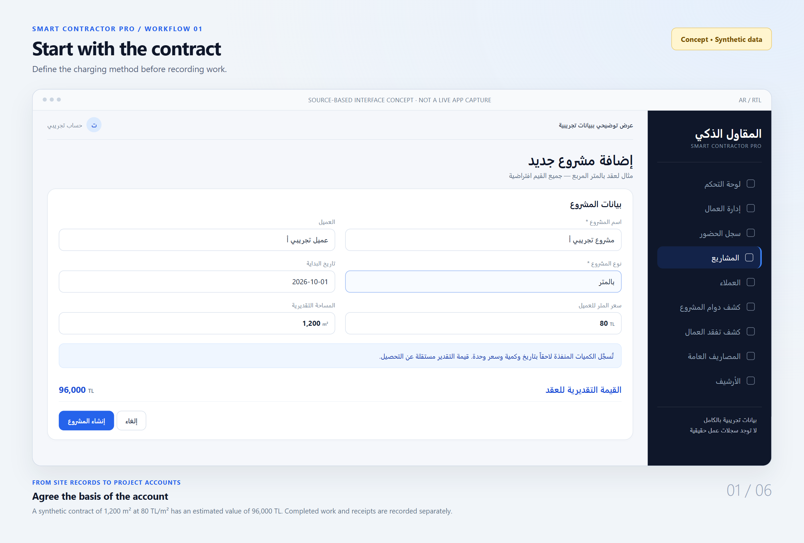
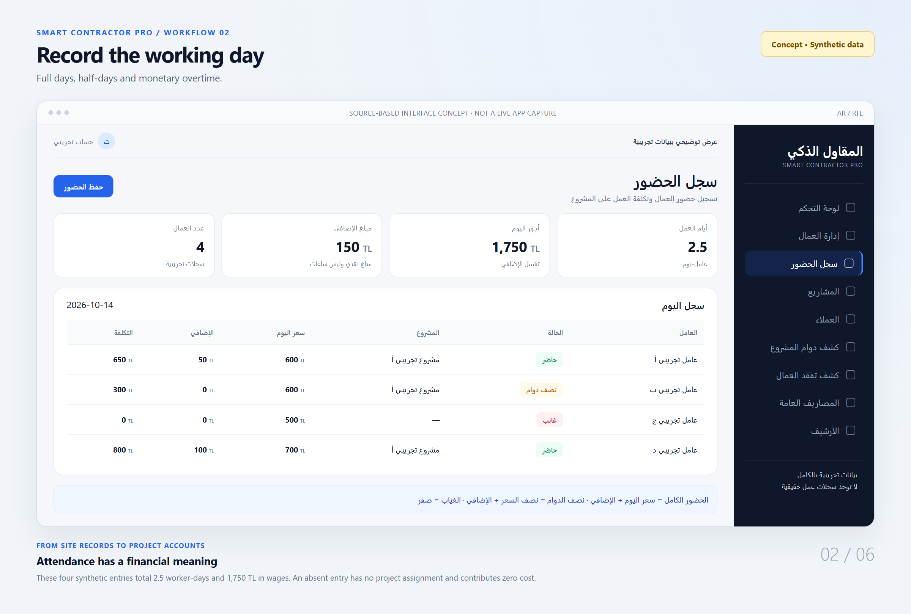
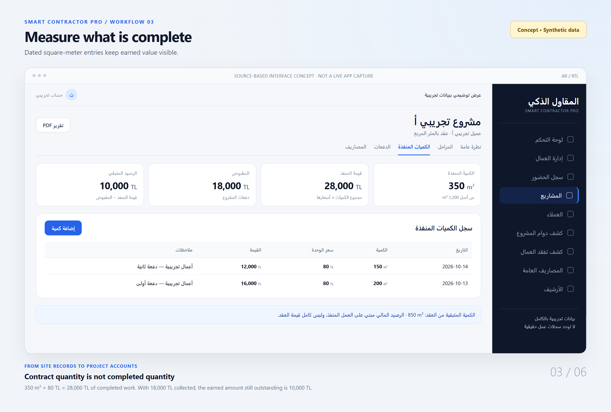
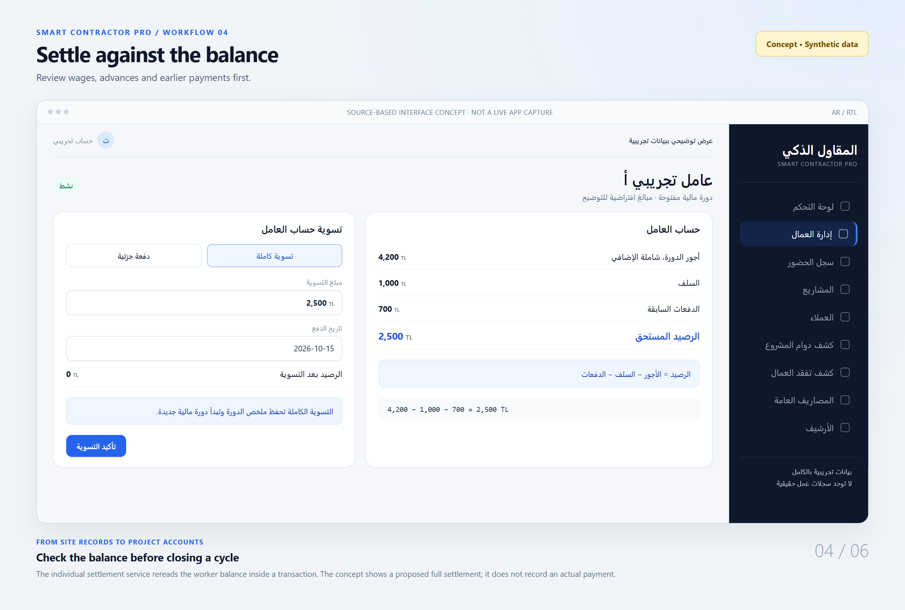
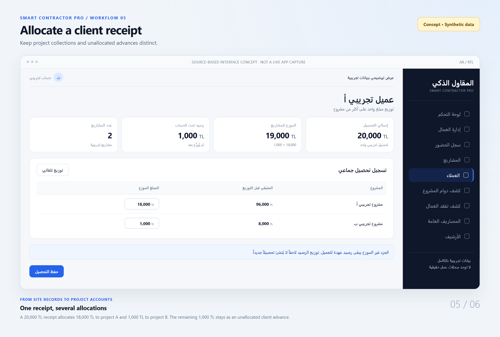
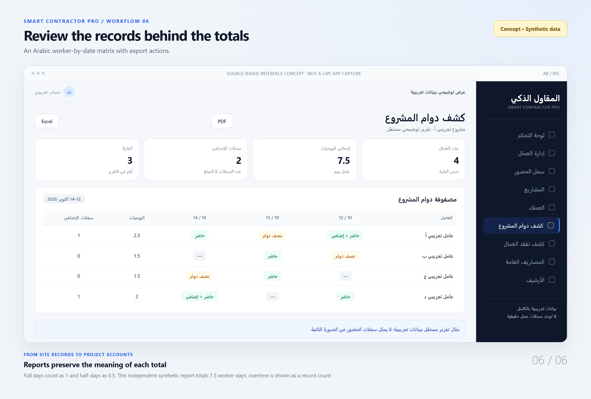

# Smart Contractor Pro

An Arabic contractor management application built for my father's construction contracting business.

## About / The Story

I developed Smart Contractor Pro to help my father with his construction contracting business. That gave the project a practical focus: keeping the work recorded on site connected to the money owed to workers and collected from clients.

Attendance, completed quantities, expenses, and payments all affect a project, but they are different records. I wanted them to make sense together without treating a day worked, an amount billed, and a payment received as the same event.

This repository is a portfolio showcase. The complete application source and business records remain private.

## What the Application Does

- Records full-day, half-day, and absent attendance, with monetary overtime and project assignments.
- Tracks worker earnings, advances, payments, and settlement cycles.
- Calculates client charges from accumulated worker-days or completed square-meter quantities.
- Records project expenses, general expenses, phases, and change orders.
- Links client receipts to allocations across projects and tracks unallocated advances.
- Provides Arabic attendance reports, account views, and PDF/spreadsheet exports.

## How It Works

A project starts with a client and a charging method. Worker records and project assignments provide the rates used by attendance calculations. Attendance contributes to worker dues and project labor costs.

For daily projects, accumulated worker-days are multiplied by the client's daily rate, independently of worker wages. A separate billing marker records how many days have been marked as billed. Collections reduce what remains to be paid; marking work as billed does not record a payment.

For square-meter projects, dated entries record completed quantity and unit price. Their value is compared with project receipts. A client's receipt can be allocated across projects, with any unallocated amount remaining as an advance balance.

Worker payments reduce the current balance. Full settlement closes the current financial cycle and saves a summary. Reporting brings these records together for review.

## Engineering Decisions

I separated the business calculations from the screens and persistence services so the attendance and account rules can be inspected independently. The application uses Firebase Authentication and owner-scoped Firestore records, with local storage adapters when Firebase is unconfigured.

The individual attendance service reads the existing record inside a transaction and applies cost and day differences. Worker settlement also checks the latest balance inside a transaction. Bulk attendance uses a different path based on reads followed by write batches; it does not have the same concurrency protection.

I kept billing and collections separate, and derived client advance balances from receipts and their allocations. PDF saving uses a browser download on the web and native filesystem/share integrations on Android.

There is more detail, including the remaining validation and concurrency gaps, in [engineering notes](docs/engineering-notes.md) and the [architecture overview](docs/architecture.md).

## App Views

All six images below are **source-based concept renders with entirely synthetic data**. They follow the application's RTL layout, controls, and workflows, but are not screenshots of a running application. Each image is visibly labeled. No real worker, client, location, or financial record is shown.

**1. Project setup** — choose the charging method and enter the contract quantity and rate.



**2. Daily attendance** — record full days, half-days, absence, and monetary overtime.



**3. Completed quantities** — compare square meters completed, earned value, and collections.



**4. Worker balances and settlements** — inspect earnings, advances, and payments before settlement.



**5. Client receipt allocation** — allocate one receipt across projects and retain the unallocated balance.



**6. Arabic reports** — review attendance by worker and date, with full and half-day totals.



The [visual notes](screenshots/README.md) document the source references and example figures.

## Selected Code Examples

These are short, verified fragments from the private application. They require their surrounding functions and dependencies; they are not standalone implementations or a reusable SDK.

**Attendance payment rules**

A half-day and a full day should not earn the same amount. This calculation applies the effective rate, adds monetary overtime to worked days, and returns zero for absence. Overtime is an amount, not a number of hours.

```ts
const rate = getEffectiveRate(worker, customRate);
const extra = Math.max(0, overtimeAmount);
if (status === 'absent') return 0;
if (status === 'present') return rate + extra;
if (status === 'half_day') return rate / 2 + extra;
return 0;
```

[Excerpt and original source reference](excerpts/01-attendance-rules.ts).

**Individual attendance corrections**

Editing an existing attendance record should apply the difference rather than add the whole wage again. This patch belongs to the individual Firestore transaction, which reads the current attendance before deriving the old values. The bulk attendance path uses separate reads and write batches and has weaker concurrency protection.

```ts
const workerPatch: Record<string, unknown> = {
  totalEarnings: increment(calculatedCost - oldCost),
  totalDays: increment(daysDelta - oldDays),
  currentBalance: increment(calculatedCost - oldCost),
  totalOvertime: increment(overtimeAmount - oldOvertime),
  updatedAt: now(),
};
```

[Excerpt and original source reference](excerpts/02-individual-attendance-deltas.ts).

**Billing and collections**

Work completed, work marked as billed, and money collected answer different questions. Accrued worker-days determine the receivable; the billing marker determines the pending billable amount; collections reduce the outstanding amount. The project client rate is separate from worker wages.

```ts
const dailyUnitPrice = project.dailyUnitPrice ?? 0;
const totalAccruedDays = project.totalAccruedDays ?? 0;
const lastBilledDays = project.lastBilledDays ?? 0;
const pendingBillableDays = Math.max(0, totalAccruedDays - lastBilledDays);
const accruedReceivable = totalAccruedDays * dailyUnitPrice;
const pendingBillableAmount = pendingBillableDays * dailyUnitPrice;

return {
  dailyUnitPrice,
  totalAccruedDays,
  lastBilledDays,
  pendingBillableDays,
  accruedReceivable,
  pendingBillableAmount,
  currentContractValue: accruedReceivable,
  remainingAmount: accruedReceivable - totalReceived,
  currentBalanceDue: pendingBillableAmount,
};
```

[Excerpt and original source reference](excerpts/03-billing-and-collections.ts).

**Worker settlement checks**

A payment screen can hold an outdated balance. Inside runTransaction, the service reads the latest worker document, checks ownership, rejects a payment above the balance, and refuses full cycle closure if the requested amount no longer matches that balance. This excerpt follows that transaction read.

```ts
const currentWorker = { id: workerSnap.id, ...workerSnap.data() } as Worker;
const balanceBefore = currentWorker.currentBalance;
if (data.amount > balanceBefore) throw new Error('مبلغ التسوية أكبر من الرصيد المستحق');

const isFullCycleClose = Boolean(data.closeCycle) && data.amount === balanceBefore;
if (data.closeCycle && !isFullCycleClose) {
  throw new Error('لا يمكن إغلاق الدورة لأن الرصيد تغيّر. حدّث الصفحة ثم أعد المحاولة.');
}

const balanceAfter = balanceBefore - data.amount;
```

[Excerpt and original source reference](excerpts/04-worker-settlement-checks.ts).

**Client receipt allocation**

Allocating a receipt to a project should not count as another receipt. Payments linked through clientPaymentId are deducted from active receipts to derive the unallocated advance balance. Closed-period records are filtered by the surrounding function. This arithmetic depends on valid receipt and project relationships; the persistence layer still needs stronger checks.

```ts
const allocated = clientProjectPayments.reduce(
  (s, p) => s + (p.clientPaymentId ? p.amount : 0),
  0
);
const activeReceipts = clientPayments.filter(isActiveClientPayment);
const receipts = activeReceipts.reduce((s, c) => s + c.totalAmount, 0);
const totalRemaining = totalContract - totalReceived;
const advanceBalance = receipts - allocated;
```

[Excerpt and original source reference](excerpts/05-client-receipt-allocation.ts).

## Tech Stack

| Area | Implementation |
| --- | --- |
| Interface | React, TypeScript, Vite, Tailwind CSS; Arabic RTL |
| Navigation and state | React Router, React hooks/context, shared subscriptions; Zustand for persisted expenses |
| Authentication | Firebase Authentication: email/password and Google sign-in |
| Data | Cloud Firestore, persistent local cache, localStorage adapters |
| Android | Capacitor integration, native authentication, filesystem and sharing |
| Reports | jsPDF, AutoTable, SheetJS/XLSX; Arabic PDF font helpers |
| Tests in source | Vitest and Firestore emulator tests |

## Current Status

The private source contains the workflows described here, an Android project, and Firebase Hosting configuration. This showcase preparation did not run, build, deploy, or test the original application. Production deployment, distribution, and measured business outcomes are not established here.

Remaining work includes stronger concurrency protection for bulk attendance and quantity limits, authoritative validation of client allocations, a consistent money-rounding policy, and account-switch cache review. Role-based company permissions are future work. Closed worker cycles retain selected summaries rather than a permanent complete payment ledger.

The implemented quantity workflow uses square meters. This showcase makes no claim of linear-meter accounting, accounting compliance, or measured financial savings.

## Source Code & Rights

Developer: [MuhammedR21](https://github.com/MuhammedR21).

The original application source remains private. Only the selected excerpts and synthetic concept visuals are included here. No general code reuse license is granted. See [RIGHTS.md](RIGHTS.md) for the scope and restrictions.
