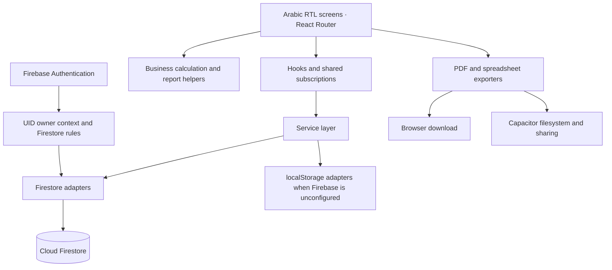

# Architecture

Smart Contractor Pro is a React/TypeScript client application with managed Firebase services and Capacitor Android integration. This overview describes inspected source, not a verified running deployment.

This is a logical dependency diagram, not a network topology. The original application does not need a custom Express API for the inspected workflows. Express appears in the dependency manifest, but no active application server was established. Metadata alone is not evidence of an AI feature.

## Records and relationships

| Record | Relationship and responsibility |
| --- | --- |
| Worker | Rates, current-cycle earnings, advances, payments, and balance |
| ProjectWorker | Worker/project association and optional custom rate |
| WorkerAttendance | Worker, date, optional project, status, overtime amount, calculated cost |
| WorkerAdvance / WorkerPayment | Distinct outflows associated with a worker |
| WorkerSettlement | Summary of a closed worker financial cycle |
| Project | Client association, charging method, contract fields, labor cost, status |
| ProjectExecutedQuantity | Dated square-meter quantity, unit price, and earned value |
| ProjectPayment | Collection assigned to a project; may link to a bulk client receipt |
| ClientPayment | Bulk receipt whose unallocated portion remains an advance |
| ClientSettlement | Snapshot and closure markers for a client financial period |
| Expenses / change orders / audit records | Costs, additional work, and recorded changes |

These relationships are application-level identifiers, not relational database foreign keys. Owner checks do not by themselves validate every linked record or financial invariant.

## Persistence and identity

`src/lib/firebase.ts` initializes Firebase Authentication and Firestore with a persistent multi-tab local cache. Services select Firestore when configured; separate localStorage adapters are available otherwise. The unconfigured local mode bypasses the authentication route gate and is not evidence of multi-user isolation.

`src/services/subscriptionHub.ts` shares a backend subscription among consumers and releases it when the last listener leaves. Service caches retain recent data. Zustand is used for the persisted expense store; it is not the sole application state layer.

`src/contexts/AuthContext.tsx` handles email/password authentication and profile state. `src/lib/googleAuth.ts` uses a web popup or native Google sign-in, then establishes a Firebase JavaScript SDK session. Firestore queries and rules use `ownerId` and the authenticated UID. Roles in the rules are future scaffolding, not enforced company permissions.

## Reporting and packaging

Report helpers construct matrices and totals separately from screen rendering. PDF exports use jsPDF/AutoTable and Arabic font helpers; spreadsheet exports use SheetJS/XLSX. `src/lib/savePdf.ts` selects browser download or Capacitor filesystem/share behavior.

Vite produces web assets. Capacitor references the web output for Android. Firebase Hosting configuration includes a single-page application rewrite. These are implementation/configuration facts; no live deployment or app-store distribution was verified.

No private configuration, deployment identifier, signing material, binary artifact, or complete application file is included in this showcase.
